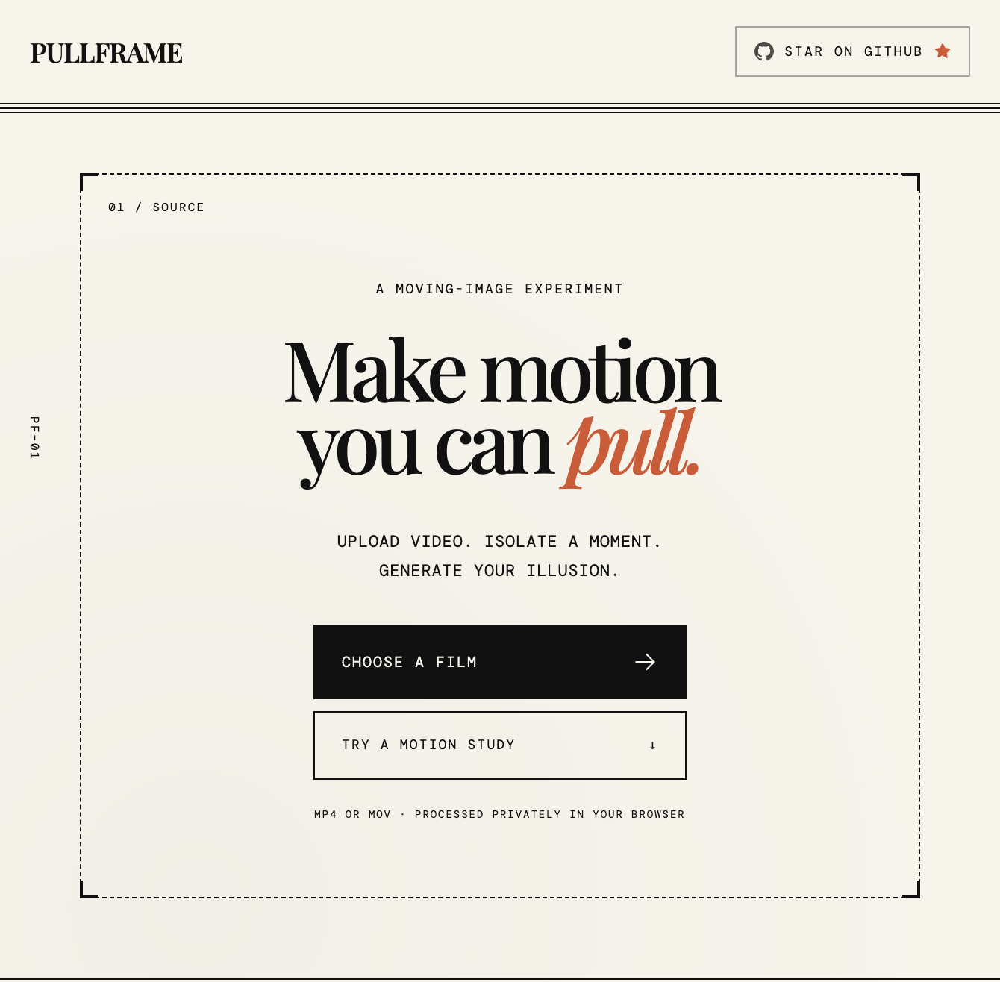

# Pullframe

Pullframe turns short videos into scanimation illusions: animated images that reveal
different frames as a striped mask moves across them.

Everything runs locally in the browser. Your video is decoded, cropped, processed,
and exported on your device; there is no upload step or backend.



## Features

- Import an MP4 or MOV by choosing a file or dragging it into the studio
- Select a one-second section from the source video
- Reposition the crop focal point for portrait, landscape, or square output
- Build a five-frame scanimation with live previews
- Preview the result as an automatic loop or an interactive pull-tab
- Adjust playback speed and respect `prefers-reduced-motion`
- Export:
  - A self-contained interactive HTML widget
  - A 1080p video reel as MP4 when supported, otherwise WebM
  - A lightweight GIF loop
- Try built-in orbit, bounce, and wave examples without uploading a video

## Requirements

- Node.js 20+ (see [`.mise.toml`](./.mise.toml) for the project toolchain)
- pnpm 9+
- A modern browser with Canvas and video decoding support

Chrome and Safari are recommended for the broadest export support. Video export
uses the browser's `MediaRecorder` implementation, so the exact format can vary
by browser.

## Getting started

```bash
pnpm install
pnpm dev
```

Open the local URL printed by Vite, usually
[`http://localhost:5173`](http://localhost:5173).

To create a production build:

```bash
pnpm build
pnpm preview
```

## Using Pullframe

1. Choose an MP4 or MOV video, or start with one of the built-in examples.
2. In the crop step, drag the timeline to select the one-second source window.
3. Drag the video to adjust its focal point and choose an output ratio.
4. Process the video to generate the interlaced scanimation.
5. Use **Auto-loop** to preview the animated mask or **Pull** to interact with it.
6. Download a widget, video reel, or GIF from the export panel.

Uploaded videos must be non-empty, at least one second long, under 10 minutes,
and smaller than 500 MB.

## Output formats

| Format | Preview size | Export size |
| --- | ---: | ---: |
| Portrait (9:16) | 540 × 960 | 1080 × 1920 |
| Landscape (16:9) | 960 × 540 | 1920 × 1080 |
| Square (1:1) | 540 × 540 | 1080 × 1080 |

The scanimation uses five interlaced frames by default. The generated widget is
a standalone HTML file and includes the image data, styling, and pointer
interaction, so it can be opened or embedded without a separate service.

## Development

The main application is in [`src/App.tsx`](./src/App.tsx). Rendering and GIF
encoding helpers live in [`src/lib/scanimation.ts`](./src/lib/scanimation.ts),
and global styles are in [`src/index.css`](./src/index.css).

Available commands:

```bash
pnpm dev       # Start the Vite development server
pnpm build     # Type-check and create the production bundle
pnpm preview   # Serve the production bundle locally
pnpm format    # Format project files with oxfmt
```

## Privacy

Pullframe processes video entirely in the browser using HTML video and Canvas APIs. Source files are not sent to a server by the application.

## License

This project is licensed under the [MIT License](./LICENSE).


